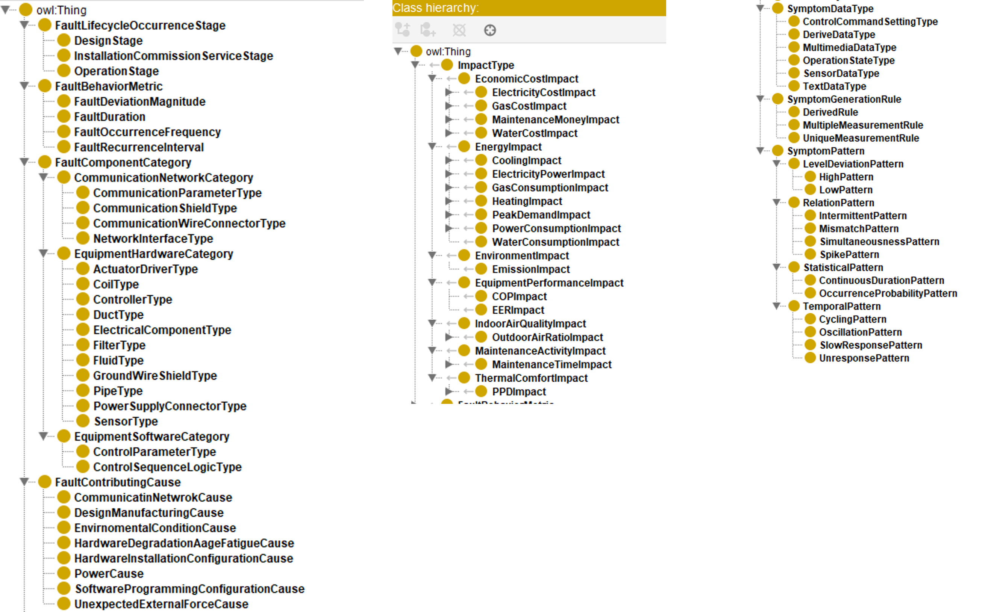

# FDD-ON (Fault detection and diagnostics ontology)
## About
Fault detection and diagnostics ontology (FDD-ON) creates a standardized structure for the classification of various types of faults and associated symptoms and impacts. FDD-ON unifies the representation of faults and symptoms among the varied terminologies and vocabularies, into a relational ontology that permits inference and reasoning of the relationships among fault concepts and is optimized toward annotating HVAC faults.

## Motivations
Fault detection and diagnosis (FDD) is essential for improving HVAC system reliability, energy efficiency, and maintenance effectiveness. However, effective deployment of FDD solutions in buildings requires structured domain knowledge that can bridge heterogeneous data sources, diverse equipment types, and varied diagnostic outputs. However, limited data interpretability and interoperability within the FDD domain have led to fragmented information silos, hindering the implementation of FDD and related applications, such as the digital twin-enabled FDD frameworks and artificial intelligence (AI)-driven maintenance decision-making systems. Four gaps are uncovered in the current FDD-related applications:

   (1) Lack of explicit cause-and-effect relations prevents effective maintenance actions. 
   (2) Lack of standardized fault terminology and representations impedes the accurate interpretation of HVAC system abnormalities and limits improvements in FDD performance, system upgrades, and operation and maintenance (O&M) practices. 
   (3) The heterogeneous data outputs generated by FDD tools have limited interoperability, causing a significant challenge for the efficient interpretation and utilization of FDD results.
   (4) The absence of a comprehensive HVAC FDD knowledge model hinders the seamless integration of emerging technologies and impedes the scalability of advanced FDD applications. 

## Methodology
### Framework
We developed a framework for developing FDD-ON. The framework includes five major phases including: 1) information and requirement analysis, 2) development ontology, 3) development of fault libraries, symptom libraries, and impact libraries, 3) ontology evaluation, and 5) limitation discussion and evolution. 

  It is noted that the development of FDD-ON is an iterative process, i.e., the evaluation result of FDD-ON should feedback to step #1 to update, extend and enhance the ontology.

  

### Semantic model

We developed a four-level semantic model, which characterizes the FDD inference and analytic processes. The model structures FDD knowledge and reasoning into four interconnected levels: 1) symptom detection, 2) fault diagnosis, 3) contributing cause identification, and 4) fault impact analysis.

  

  We used RDFS (Resource Description Framework Schema) and OWL (Web Ontology Language), which are based on the World Wide Web Consortium's (W3C) standards, to develop the semantic model for data interchange on the web that allows for modeling graphs of resources over the web

  The semantic structure example of FDD-ON for representing a fault type. 

  

  The semantic structure example of FDD-ON for representing a symptom type.

  

### Controlled vocabulary

 The controlled vocabulary can represent fault types and symptom statuses identified in the HVAC operations. This enhances the preciseness of the semantic meanings of fault types and symptom statuses, the interpretability of reporting faults and symptoms, as well as the interoperability of data across different systems. The controlled vocabulary will be encoded into the fault naming structure and symptom naming structure. 

### Taxonomy

  A set of taxonomies were developed to classify fault attributes and symptom attributes. 
  For fault attributes, taxonomies include four sub classes: 1) fault behavior metric; 2) component category; 3) contributing cause; and 4) lifecycle occurrence stage.
  For symptom attributes, taxonomies include two sub classes as: 1) symptom behaviors, and 2) data types.
  For impact types, taxonomies include seven sub classes as: 1) equipment performance, 2) energy, 3) economic cost, 4) indoor air quality, 5) thermal comfort, 6) maintenance activity, and 7) environment.
  Below graphic illustrates the taxonomoy structures for fault attributes, symptom attributes and impact types.

  

### Implementation of semantic modelling
  In this study, we translate the semantic model of FDD-ON into OWL and RDFS using Protégé software.  

## Development of Libraries
### Naming convention

  All fault names, symptom names and impact names are constructed into a four-section structure, namely a **quadrinomial nomenclature**. The four-section structure encodes fundamental information to illustrate a fault type, symptom status and impact type. In each section, Pascal Case notations are adopted to represent specific pieces of information that are associated with characteristics of faults, symptoms and impact types.

### Libraries

  FDD-ON includes three major libraries, i.e., fault library, symptom library and impact library for each type of subsystem and equipment. Currently, there are 469 fault types, 468 symptom statuses, and 241 fault impact types, have been included in the fault library and symptom library, respectively (FDD-ON library version 2026B). 

## Evaluation
### Quantitative evaluation

  Various ontology metrics and the completeness were analyzed to quantitatively evaluate FDD-ON. 

### Qualitative evaluation

  The consistency examination was carried out to assess logical expressivity.

### Application evaluation
  The semantic modelling approach of FDD-ON was compared with other ontologies to demonstrate the enhancement of FDD-ON in representing FDD domain knowledge and application areas. 

## Feature

* Semantic model:  A complete semantic model to represent fault natures (i.e., fault locations, faulty components, fault contributing causes) and symptom characteristics (i.e., symptom data type, symtpom pattern, and symptom generation rule), as well as their relations.
* Definition: A clear definition for each type of fault and illustration of fault nature based classification of faults. A unified fault/symptom naming conventions were developed by integrating and connecting synonymous fault concepts in various sources.
* Library: The evolving fault libraries, symptom libraries and impact libraris to efficiently retrieve fault types, associated symptoms and impacts.
* Taxonomy: A taxonomy framework to enhance information representation for various applications, including FDD solution development, evaluation and benchmarking, for fault occurrence and prevalence statistics, for enhancing maintenance.
